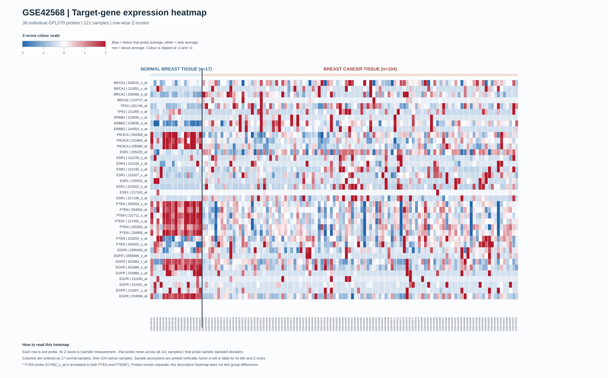

# OncoMap: Breast Cancer Gene-Expression Exploration

**Project:** OncoMap – Breast Cancer Bioinformatics Explorer  
**Report type:** Exploratory undergraduate research report  
**Dataset:** NCBI GEO GSE42568  
**Platform:** Affymetrix Human Genome U133 Plus 2.0 Array (GPL570)

## 1. Abstract

This exploratory project examines breast-tissue gene-expression data from the public NCBI Gene Expression Omnibus (GEO) series GSE42568. The series contains 121 samples: 104 breast cancer tissue samples and 17 normal breast tissue samples. The measurements were generated using the Affymetrix GPL570 microarray platform. Eight genes were selected for focused exploration: BRCA1, BRCA2, TP53, ERBB2, PIK3CA, ESR1, PTEN and EGFR.

Probe identifiers were matched to these genes using exact tokens in the GPL570 annotation file's `Gene symbol` column. The existing GEO2R results table contains 54,675 probes; 38 target probes were identified and retained as separate observations. At the adjusted P-value threshold of less than 0.05, 18 of the 38 probes were significant: 14 had negative log fold changes and four had positive log fold changes for the cancer-versus-normal comparison. The results are probe-level, and some probes for the same gene differ in direction or significance. One PTEN-associated probe is also annotated to PTENP1.

The volcano plot and heatmap provide complementary visual summaries of the supplied results and expression data. All findings are descriptive and exploratory. They do not establish causation, diagnose cancer, or support clinical decisions.

## 2. Introduction

Breast cancer comprises tumours with varied biological characteristics. Gene-expression microarrays measure signal associated with many RNA transcripts at once. These measurements can be used to explore differences between tissue groups, but a microarray probe is not always equivalent to one unique gene: multiple probes may map to one gene, and an individual probe may be annotated to more than one gene.

OncoMap uses an existing GEO2R differential-expression table and the corresponding GEO series matrix to provide a focused view of eight selected breast cancer-associated genes. The work emphasizes transparent probe-level reporting. It does not combine probes into one gene score, rerun the GEO2R model, or make clinical predictions.

## 3. Research Question

> How do selected breast cancer-associated gene-expression probes differ between normal breast tissue and breast cancer tissue?

## 4. Research Objectives

1. Describe the GSE42568 dataset and its sample groups.
2. Match GPL570 probe identifiers to the eight selected genes using exact gene-symbol tokens.
3. Check that the selected probe rows are present in the expression matrix and have measurements across the samples.
4. Summarize the supplied GEO2R log fold changes and adjusted P-values for every selected probe.
5. Interpret the volcano plot and heatmap without combining different probes or making diagnostic claims.

## 5. Dataset Description

GSE42568 is a human breast cancer gene-expression study hosted by NCBI GEO [1]. The sample titles in the series matrix identify 104 breast cancer tissue samples and 17 normal breast tissue samples, for 121 samples in total. The samples were measured on the Affymetrix Human Genome U133 Plus 2.0 Array, GEO platform GPL570 [2].

The project uses the existing series matrix (`../Data/raw/GSE42568_series_matrix.txt.gz`), GPL570 annotation file (`../Data/annotation/GPL570.annot.gz`) and GEO2R results table (`../Data/processed/GSE42568.top.table.tsv`). The matrix has 54,675 probe rows and 121 sample columns. The series/platform records describe GC-RMA-processed array data; this report uses those supplied processed measurements and does not reprocess raw CEL files [1, 6].

## 6. Biological Background of the Eight Genes

The selected genes represent several biological themes. These brief descriptions provide context for the exploratory panel; they do not imply that expression differences in this dataset demonstrate a mechanism.

| Gene | Biological theme | Brief context |
|---|---|---|
| BRCA1 | DNA repair | Associated with DNA damage response and repair. [7] |
| BRCA2 | DNA repair | Associated with homologous-recombination DNA repair. [8] |
| TP53 | Tumour suppression | Encodes p53, a regulator of cellular stress responses, cell-cycle control and apoptosis. [9] |
| ERBB2 | Cell growth signalling | Encodes a receptor tyrosine kinase involved in growth-related signalling. [10] |
| PIK3CA | Cell growth signalling | Encodes the catalytic alpha subunit of class I phosphatidylinositol 3-kinase. [11] |
| ESR1 | Hormone receptor signalling | Encodes estrogen receptor alpha, a hormone-responsive transcription regulator. [12] |
| PTEN | Tumour suppression | Encodes a tumour suppressor that negatively regulates PI3K-related signalling. [13] |
| EGFR | Cell growth signalling | Encodes the epidermal growth factor receptor, a receptor tyrosine kinase. [14] |

## 7. Materials and Methods

The analysis used the three existing project data files listed in Section 5 and the two existing visualisations linked in Sections 11 and 12. The GEO2R results were read from the supplied TSV. The expression matrix's sample accessions and titles were used to identify and align its sample columns with the normal and cancer groups. No files were altered as part of the analysis described here.

The target panel was restricted to BRCA1, BRCA2, TP53, ERBB2, PIK3CA, ESR1, PTEN and EGFR. Probe records were identified from GPL570 annotation by splitting each `Gene symbol` field on `///` and comparing the resulting tokens to the target symbols exactly. All 38 matching probe IDs were found in the GEO2R table and expression matrix. The matrix validation found a numeric measurement for each of the 121 samples for each target probe.

## 8. Probe Annotation and Data Preparation

The GPL570 annotation table includes an `ID` field for array probe IDs and a `Gene symbol` field for gene-symbol annotations. The symbol field can contain multiple entries separated by `///`. Exact-token matching avoids counting a symbol merely because its letters appear within another symbol.

The annotation lookup produced 38 target probes: BRCA1 (2), BRCA2 (2), TP53 (2), ERBB2 (3), PIK3CA (3), ESR1 (9), PTEN (8) and EGFR (9). All 38 were present as rows in the expression matrix. Each probe was kept separate throughout the differential-expression summary. Probe `217492_s_at` is annotated to both `PTENP1` and `PTEN`; it is included under PTEN for the exact-token lookup but flagged as ambiguous.

## 9. Statistical Analysis Using GEO2R/limma

This report summarizes, rather than reruns, the existing GEO2R analysis. GEO2R provides differential-expression results using the limma framework [3, 4]. The TSV includes a log fold change (`logFC`), raw P-value (`P.Value`) and multiple-testing-adjusted P-value (`adj.P.Val`) for each probe. The supplied adjusted P-values use the Benjamini-Hochberg procedure to control the false discovery rate across many tests [5].

The significance rule used here is **adjusted P-value < 0.05**. Values equal to or above 0.05 are reported as not meeting this threshold. For the supplied cancer-versus-normal comparison, positive logFC indicates a higher reported measurement in cancer tissue than normal breast tissue; negative logFC indicates a lower measurement in cancer. This sign interpretation is consistent with the normal and cancer sample groups identified from the matrix titles and their measured expression values.

**Reproducibility note:** Matrix sample columns were matched to `!Sample_geo_accession` and `!Sample_title` metadata. Titles beginning `Normal breast` defined the normal group, and titles beginning `Breast cancer` defined the cancer group, giving 17 normal and 104 cancer samples. The GEO2R cancer-versus-normal logFC direction was checked against the corresponding group-mean direction in the matrix for the target probes: positive logFC corresponds to a higher cancer-group mean, and negative logFC to a lower cancer-group mean.

## 10. Results

The GEO2R TSV contains 54,675 probe rows. Of the 38 selected target probes, **18 met adjusted P-value < 0.05**: **four** had positive logFC and **14** had negative logFC. The other **20 probes did not meet** this adjusted-P threshold.

| Gene | Target probes | Significant probes | Significant direction(s) |
|---|---:|---:|---|
| BRCA1 | 2 | 0 | None |
| BRCA2 | 2 | 1 | 1 higher in cancer |
| TP53 | 2 | 1 | 1 higher in cancer |
| ERBB2 | 3 | 1 | 1 higher in cancer |
| PIK3CA | 3 | 3 | 3 lower in cancer |
| ESR1 | 9 | 1 | 1 higher in cancer |
| PTEN | 8 | 6 | 6 lower in cancer; one is PTEN/PTENP1-ambiguous |
| EGFR | 9 | 5 | 5 lower in cancer |
| **Total** | **38** | **18** | **4 higher; 14 lower** |

The following table reports every target probe individually. `logFC` direction is for cancer relative to normal. Adjusted P-values below 0.001 are shown in scientific notation; larger values are shown as decimals. “Significant” means only that the supplied adjusted P-value is below 0.05; it is not a statement about clinical importance.

| Target gene | Probe ID | GEO2R gene symbol(s) | logFC (cancer - normal) | Adjusted P-value | Result |
|---|---|---|---:|---:|---|
| BRCA1 | `204531_s_at` | BRCA1 | 0.357 | 0.17 | Not significant |
| BRCA1 | `211851_x_at` | BRCA1 | 0.00335 | 0.979 | Not significant |
| BRCA2 | `208368_s_at` | BRCA2 | 0.536 | 0.00151 | Significant; higher in cancer |
| BRCA2 | `214727_at` | BRCA2 | 0.019 | 0.654 | Not significant |
| TP53 | `201746_at` | TP53 | 0.671 | 0.0167 | Significant; higher in cancer |
| TP53 | `211300_s_at` | TP53 | 0.0371 | 0.688 | Not significant |
| ERBB2 | `210930_s_at` | ERBB2 | 0.0683 | 0.652 | Not significant |
| ERBB2 | `216836_s_at` | ERBB2 | 3.12 | 3.52e-08 | Significant; higher in cancer |
| ERBB2 | `234354_x_at` | ERBB2 | 0.499 | 0.162 | Not significant |
| PIK3CA | `204369_at` | PIK3CA | -1.47 | 1.89e-08 | Significant; lower in cancer |
| PIK3CA | `231854_at` | PIK3CA | -1.29 | 3.70e-16 | Significant; lower in cancer |
| PIK3CA | `235980_at` | PIK3CA | -1.08 | 9.62e-09 | Significant; lower in cancer |
| ESR1 | `205225_at` | ESR1 | 1.75 | 0.105 | Not significant |
| ESR1 | `211233_x_at` | ESR1 | 0.0555 | 0.648 | Not significant |
| ESR1 | `211234_x_at` | ESR1 | 0.0612 | 0.429 | Not significant |
| ESR1 | `211235_s_at` | ESR1 | 0.114 | 0.414 | Not significant |
| ESR1 | `211627_x_at` | ESR1 | 0.103 | 0.722 | Not significant |
| ESR1 | `215551_at` | ESR1 | 0.0348 | 0.831 | Not significant |
| ESR1 | `215552_s_at` | ESR1 | 0.924 | 0.0419 | Significant; higher in cancer |
| ESR1 | `217163_at` | ESR1 | 0.00127 | 0.966 | Not significant |
| ESR1 | `217190_x_at` | ESR1 | 0.17 | 0.18 | Not significant |
| PTEN | `204053_x_at` | PTEN | -2.03 | 9.78e-13 | Significant; lower in cancer |
| PTEN | `204054_at` | PTEN | -1.12 | 3.73e-08 | Significant; lower in cancer |
| PTEN | `211711_s_at` | PTEN | -2.37 | 4.41e-15 | Significant; lower in cancer |
| PTEN* | `217492_s_at` | PTENP1 /// PTEN | -2.02 | 1.66e-13 | Significant; lower in cancer; ambiguous annotation |
| PTEN | `225363_at` | PTEN | -1.21 | 9.55e-05 | Significant; lower in cancer |
| PTEN | `228006_at` | PTEN | -1.98 | 4.34e-12 | Significant; lower in cancer |
| PTEN | `233254_x_at` | PTEN | 0.241 | 0.375 | Not significant |
| PTEN | `242622_x_at` | PTEN | 0.348 | 0.0853 | Not significant |
| EGFR | `1565483_at` | EGFR | 0.116 | 0.826 | Not significant |
| EGFR | `1565484_x_at` | EGFR | 0.163 | 0.547 | Not significant |
| EGFR | `201983_s_at` | EGFR | -2.51 | 3.89e-05 | Significant; lower in cancer |
| EGFR | `201984_s_at` | EGFR | -2.09 | 9.35e-08 | Significant; lower in cancer |
| EGFR | `210984_x_at` | EGFR | -0.357 | 5.92e-4 | Significant; lower in cancer |
| EGFR | `211550_at` | EGFR | 0.00226 | 0.928 | Not significant |
| EGFR | `211551_at` | EGFR | -0.111 | 0.179 | Not significant |
| EGFR | `211607_x_at` | EGFR | -0.226 | 0.0445 | Significant; lower in cancer |
| EGFR | `224999_at` | EGFR | -2.39 | 7.14e-08 | Significant; lower in cancer |

\* Probe `217492_s_at` is annotated to both PTENP1 and PTEN. Its result cannot be attributed uniquely to PTEN based on this annotation alone.

## 11. Volcano Plot Interpretation

Each point represents one of the 54,675 probes. The horizontal axis is logFC, and the vertical axis is -log10(adjusted P-value). The horizontal reference line marks adjusted P = 0.05; the vertical reference line marks logFC = 0. Probes beyond the adjusted-P threshold are colored by the sign of logFC, while non-significant probes are grey. The selected target probes are outlined, with significant target probes labeled.

The plot visualizes statistical evidence and direction for individual probes. It does not turn multiple probes into one gene-level result, and a point passing the threshold does not by itself establish biological importance.

## 12. Heatmap Interpretation

The heatmap contains 38 separate probe rows and 121 sample columns. The 17 normal samples appear first, followed by the 104 breast cancer samples. Each row is standardized separately across all 121 samples: blue indicates a value relatively below that probe's overall mean, white is near its mean, and red is relatively above it. The displayed color range is clipped at Z-scores of -2 and +2. The PTEN/PTENP1-ambiguous probe is marked.

These colors describe relative values within each probe row. They are not P-values, do not indicate significance, and should not be compared as absolute expression levels between different probe rows.

## 13. Discussion

The supplied GEO2R results show a probe-level pattern in which 14 significant probes have negative logFC and four have positive logFC for cancer relative to normal tissue. All three PIK3CA probes and six PTEN-associated probes meet the adjusted-P threshold with negative logFC; the PTEN set includes the ambiguous PTENP1/PTEN probe. Five EGFR probes meet the threshold with negative logFC. One probe each for BRCA2, TP53, ERBB2 and ESR1 meets the threshold with positive logFC.

These observations are specific to the probes, samples, preprocessing and comparison represented in GSE42568. They should not be restated as “PIK3CA is lower” or “ERBB2 is higher” at the gene level without a justified approach to combining or selecting probes. In several cases, probes for the same gene have different effect sizes or different significance results. The PTENP1/PTEN annotation is an additional reason to avoid treating every probe as a unique measurement of one gene.

The heatmap offers a visual description of sample-level expression relative to each probe's own average. The volcano plot summarizes the supplied logFC and adjusted P-values. Neither visualization establishes why a difference occurs. Follow-up work would need to define an analysis plan, consider clinical and technical covariates, and validate findings in an independent dataset before making stronger biological claims.

## 14. Limitations

- The sample groups are imbalanced: 104 cancer samples and 17 normal samples.
- The report summarizes a supplied GEO2R table; it does not independently reproduce the study design, model matrix, covariate handling or preprocessing.
- Microarray probes measure array-specific hybridization signals. Probe annotation can be outdated, can map multiple probes to one gene, or can map one probe to multiple symbols.
- Results are based on one public cohort and the selected gene panel. They require independent validation and should not be generalized to all breast cancers.
- An adjusted P-value threshold is not a measure of clinical importance, and non-significance does not prove that no difference exists.
- The heatmap uses row-wise Z-scores, so its colors show relative values within a probe and not absolute expression comparisons between probes.
- These exploratory, observational data cannot establish causation and cannot diagnose cancer or guide treatment.

## 15. Conclusion

This project assembled a transparent probe-level exploration of eight breast cancer-associated genes in GSE42568. The annotation and matrix contain 38 matching target probes, each with measurements across the 121 samples. In the existing GEO2R table, 18 of the 38 probes have adjusted P-values below 0.05: 14 with negative and four with positive logFC for cancer relative to normal tissue. The findings vary across probes, including within the same gene, and one significant PTEN-associated probe is also annotated to PTENP1. The results and figures are useful for learning and hypothesis generation, but further analysis and independent validation are needed for gene-level or biological conclusions.

## 16. References

1. NCBI Gene Expression Omnibus. **GSE42568: Breast Cancer Gene Expression Analysis.** [https://www.ncbi.nlm.nih.gov/geo/query/acc.cgi?acc=GSE42568](https://www.ncbi.nlm.nih.gov/geo/query/acc.cgi?acc=GSE42568)
2. NCBI Gene Expression Omnibus. **GPL570: Affymetrix Human Genome U133 Plus 2.0 Array.** [https://www.ncbi.nlm.nih.gov/geo/query/acc.cgi?acc=GPL570](https://www.ncbi.nlm.nih.gov/geo/query/acc.cgi?acc=GPL570)
3. NCBI. **GEO2R: Analyze GEO data.** [https://www.ncbi.nlm.nih.gov/geo/geo2r/](https://www.ncbi.nlm.nih.gov/geo/geo2r/)
4. Ritchie ME, Phipson B, Wu D, Hu Y, Law CW, Shi W, Smyth GK. limma powers differential expression analyses for RNA-sequencing and microarray studies. *Nucleic Acids Research*. 2015;43(7):e47. [https://doi.org/10.1093/nar/gkv007](https://doi.org/10.1093/nar/gkv007)
5. Benjamini, Y., & Hochberg, Y. (1995). Controlling the false discovery rate: A practical and powerful approach to multiple testing. *Journal of the Royal Statistical Society: Series B (Methodological), 57*(1), 289-300. [https://doi.org/10.1111/j.2517-6161.1995.tb02031.x](https://doi.org/10.1111/j.2517-6161.1995.tb02031.x)
6. Wu Z, Irizarry RA, Gentleman R, Martinez-Murillo F, Spencer F. A model-based background adjustment for oligonucleotide expression arrays. *Journal of the American Statistical Association*. 2004;99(468):909-917. [https://doi.org/10.1198/016214504000000683](https://doi.org/10.1198/016214504000000683)
7. NCBI Gene. **BRCA1, human Gene ID 672.** [https://www.ncbi.nlm.nih.gov/gene/672](https://www.ncbi.nlm.nih.gov/gene/672)
8. NCBI Gene. **BRCA2, human Gene ID 675.** [https://www.ncbi.nlm.nih.gov/gene/675](https://www.ncbi.nlm.nih.gov/gene/675)
9. NCBI Gene. **TP53, human Gene ID 7157.** [https://www.ncbi.nlm.nih.gov/gene/7157](https://www.ncbi.nlm.nih.gov/gene/7157)
10. NCBI Gene. **ERBB2, human Gene ID 2064.** [https://www.ncbi.nlm.nih.gov/gene/2064](https://www.ncbi.nlm.nih.gov/gene/2064)
11. NCBI Gene. **PIK3CA, human Gene ID 5290.** [https://www.ncbi.nlm.nih.gov/gene/5290](https://www.ncbi.nlm.nih.gov/gene/5290)
12. NCBI Gene. **ESR1, human Gene ID 2099.** [https://www.ncbi.nlm.nih.gov/gene/2099](https://www.ncbi.nlm.nih.gov/gene/2099)
13. NCBI Gene. **PTEN, human Gene ID 5728.** [https://www.ncbi.nlm.nih.gov/gene/5728](https://www.ncbi.nlm.nih.gov/gene/5728)
14. NCBI Gene. **EGFR, human Gene ID 1956.** [https://www.ncbi.nlm.nih.gov/gene/1956](https://www.ncbi.nlm.nih.gov/gene/1956)
